# Samsa Vitrin · 11 Farklı Dünya

Tek bir kişisel web sitesi fikri için hiçbir framework ya da derleme aracı kullanmadan, saf HTML, CSS ve JavaScript ile hazırlanmış 11 tasarım çalışması. Her sayfa temsil ettiği fiziksel nesnenin ya da basılı materyalin kurallarıyla çalışıyor: mimari pafta ölçü ve kesit veriyor, kasetçalar ses çalıyor, teleferik bileti zımbalanıyor, baskı tezgâhı baktıkça sararıyor.

Ana sitede seçilen sürüm ([Pafta A-01 · Mimari](https://github.com/osmansahin/samsa)) bu koleksiyonun ilk kartındaki çalışmadır.

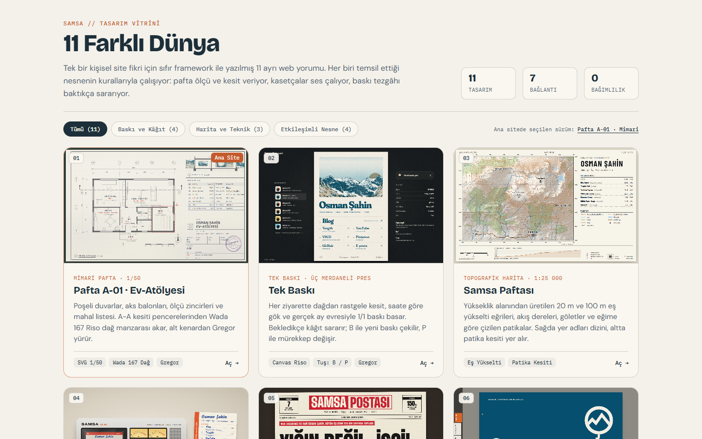

## Yerelde Çalıştırma

Tüm sayfalar statik dosyalardan oluşur. CSS `mask-image` ve yerel dosya isteklerinin tarayıcıda sorunsuz çalışması için klasör kökünden basit bir yerel HTTP sunucusu başlatmak yeterlidir:

```bash
python -m http.server 8080
```

Ardından tarayıcıda `http://localhost:8080` adresini açabilirsiniz.

---

## Tasarımlar

### 01 · Pafta A-01 · Ev-Atölyesi (`mimari/`)

Poşeli duvarlar, kapı açılım yayları, aks balonları, ölçü zincirleri ve etkileşimli mahal listesiyle 1/50 ölçekli mimari ozalit pafta. A-A kesitindeki pencerelerden Wada 167 paletli kayan Riso dağ manzarası görünür; alt kenardan zaman zaman Gregor yürür.

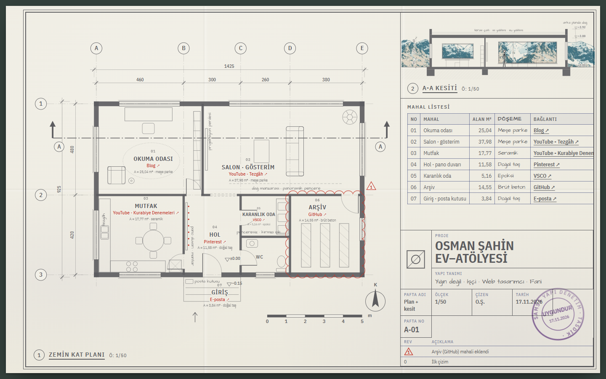

---

### 02 · Tek Baskı (`tekbaski/`)

Her ziyarette dağ siluetinden rastgele bir kesit, günün saatine göre gökyüzü ve gerçek ay evresiyle 1/1 üç merdaneli Riso baskısı üretir. Kâğıt ekranda kaldıkça sararır; `B` tuşu yeni baskı çeker, `P` tuşu mürekkep paletini değiştirir.

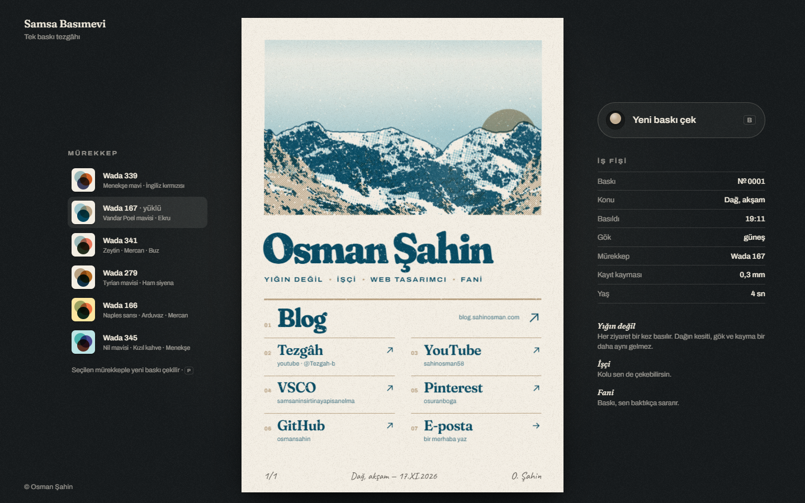

---

### 03 · Samsa Paftası (`pafta/`)

Yükseklik alanından üretilen 20 metre ve 100 metre eş yükselti eğrileri, akışla oluşan dereler, göletler ve eğime göre çizilmiş patikalar. Sağ sütunda yer adları dizini, alt kısımda ise patika yükselti kesiti yer alır.

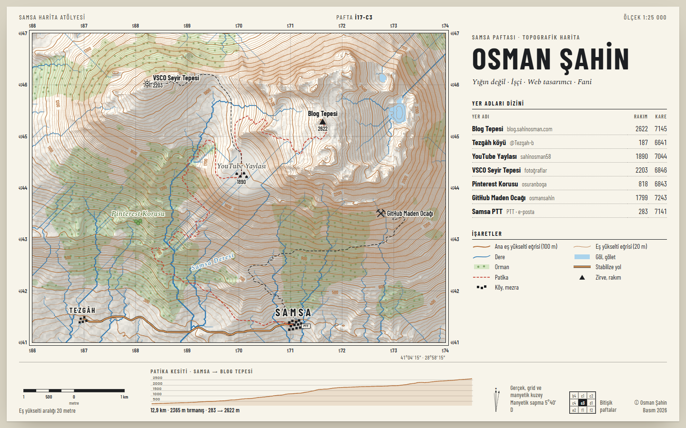

---

### 04 · OS-58 Stereo (`teyp/`)

Dönen kaset makaraları, mekanik sayaç, VU ibreleri, ses/ton düğmeleri ve kilitlenen piyano tuşlarıyla etkileşimli bir kasetçalar. Çal tuşuna basıldığında Web Audio ile gerçekten ses çalar; bağlantılar sağdaki kaset kapağında sıralanır.

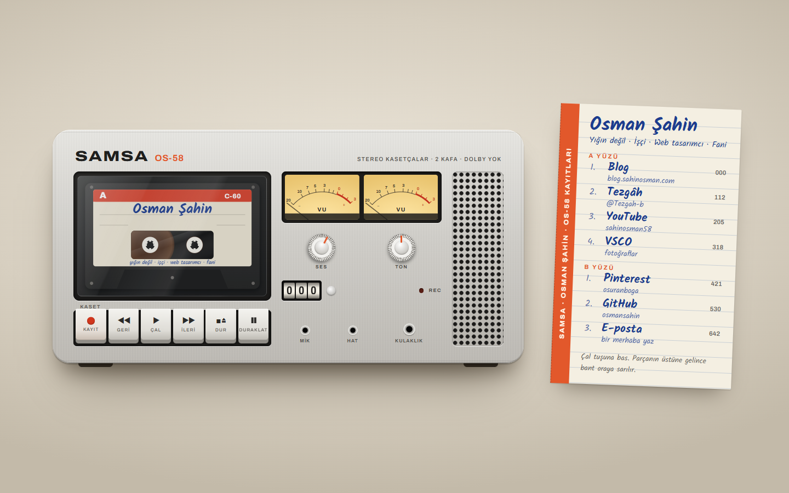

---

### 05 · Samsa Postası (`gazete/`)

Kırmızı kulaklar, büyük manşet, gazete tramıyla basılmış dağ fotoğrafı, başyazı, ilanlar ve içindekiler kutusuyla katlama izli 80'ler broadsheet gazete sayfası.

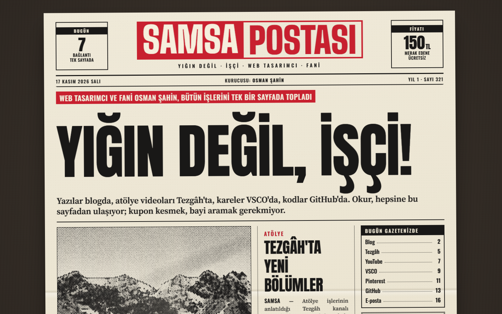

---

### 06 · Kimlik Kılavuzu (`styleguide/`)

Kapak, dağ silueti ile Ş çengelini birleştiren amblem inşası, koruma alanı, yanlış kullanım örnekleri, HEX/RGB/CMYK renk tabloları ve yazı numunesiyle sekmeli grafik standartlar kitabı.

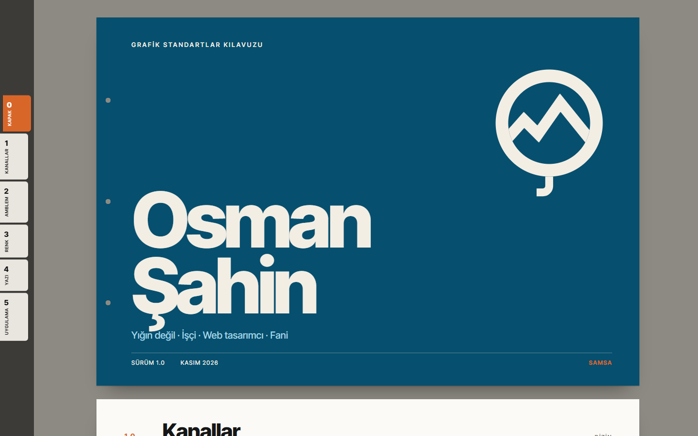

---

### 07 · Kemer (`kemer/`)

Sıvalı duvarda yelpaze kayıtlı kemerli pencere, günün saatine göre renk değiştiren gökyüzü ve fareyle hareket eden paralaks dağ silueti. Bağlantılar pencere pervazındaki kitap sırtlarında, isim ise emaye sokak tabelasında yer alır.

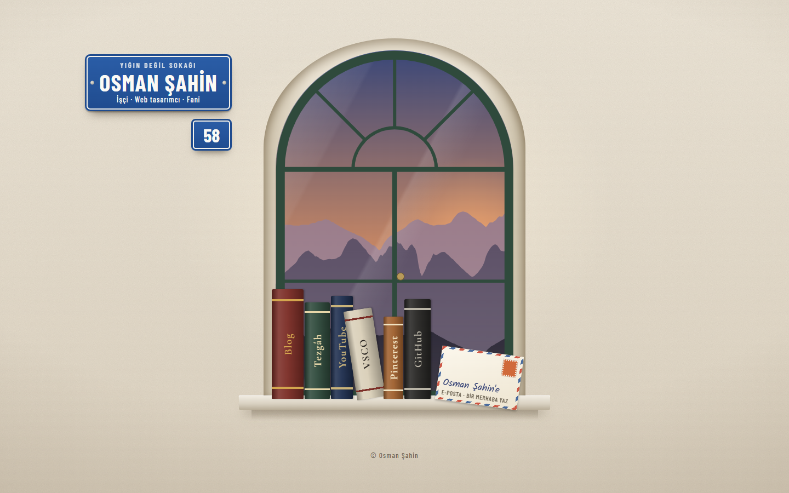

---

### 08 · Samsa Arşivi (`sekmeler/`)

Manila klasörler ve daktilo etiketlerden oluşan dosya dolabı. Sekmelere tıklayınca dosya kalkar; yanında personel kartı, kontak baskı, dilekçe ya da lastik damgalı daktilo evrakı açılır.

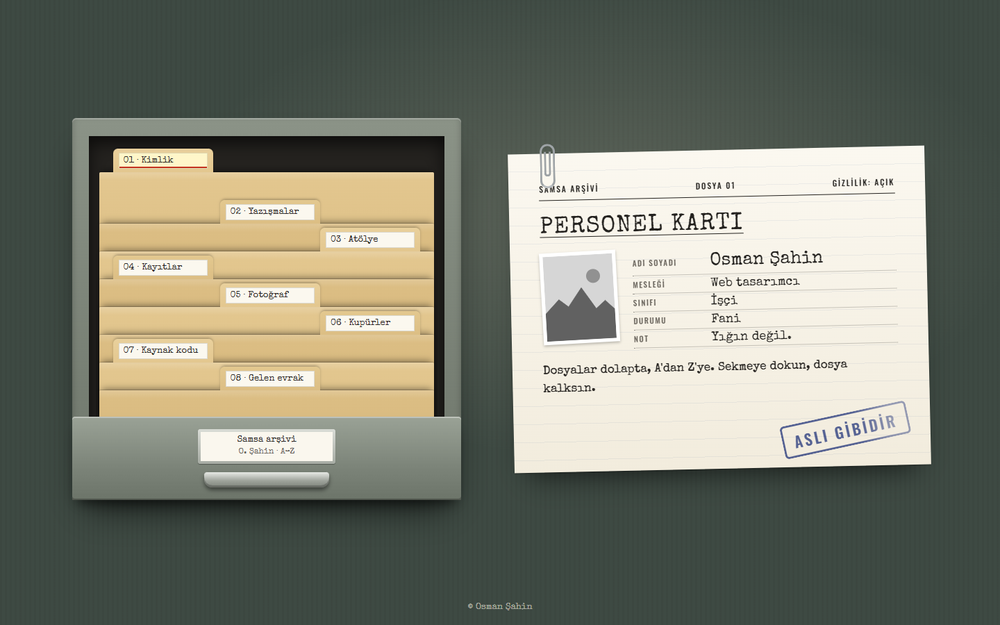

---

### 09 · Kolaj (`kolaj/`)

Dergiden kesilmiş harfler, Dymo bant, yırtık Riso baskı, gazete kupürü, kraft etiket, polaroid, sürekli form ve posta pulu. Masadaki bütün kâğıt parçaları fareyle sürüklenip yeniden dizilebilir.

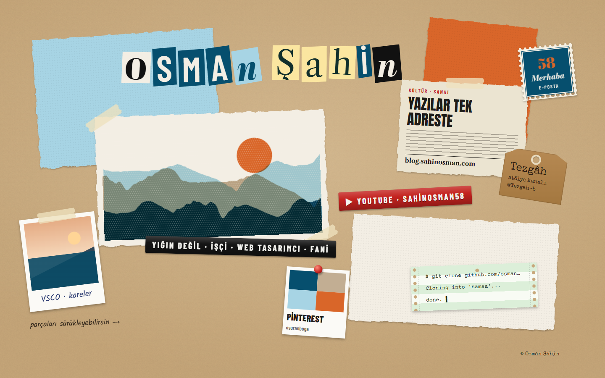

---

### 10 · Samsa Teleferiği (`bilet/`)

Gülloş desenli güvenlik baskılı biletler, koçan çizgisi, perforaj ve kırmızı seri numaraları. Her hat bir bağlantıya açılır; bilete tıklandığında görevli zımbayı basar.

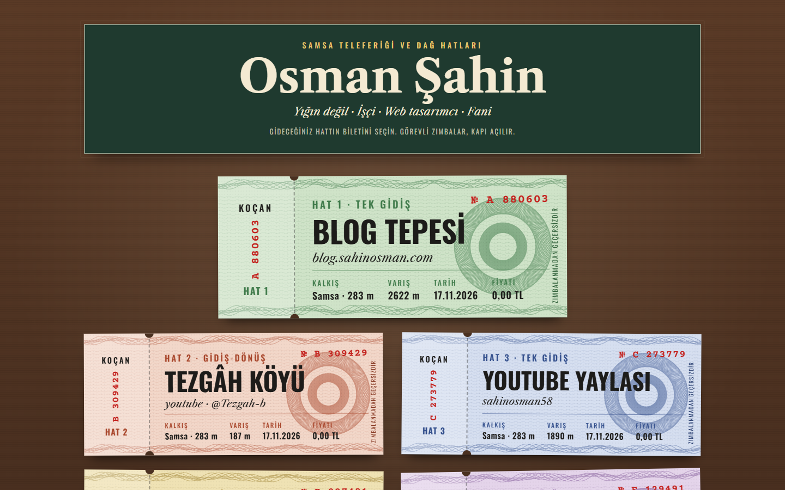

---

### 11 · Riso Panorama (`riso/`)

Kök tasarıma en yakın sade tek sayfa Riso yorumu. Üç mürekkep kalıbı tek canvas şeridinde birleşip alttan kesintisiz kayar; `P` tuşuyla 10 farklı Wada Sanzo paleti arasında geçiş yapılır.

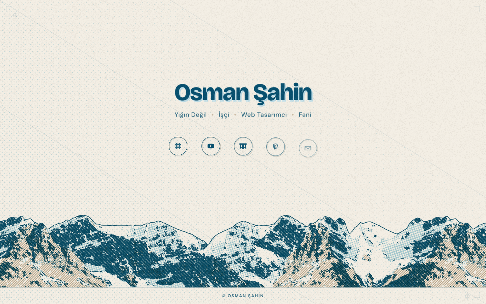
